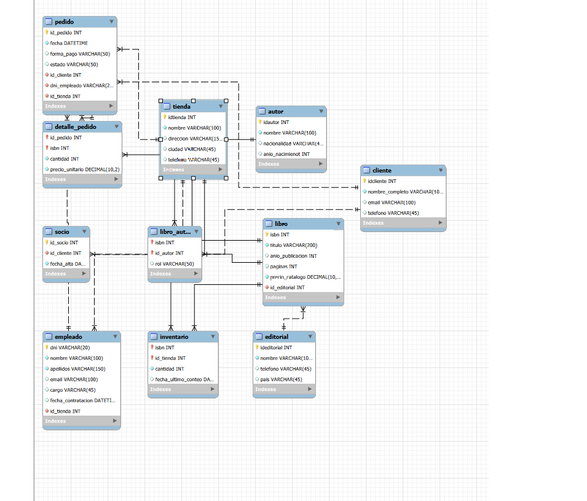

# Base de datos de Páginas de Villa Serena

## 1. Resumen del caso

Este caso trata de hacer una base de datos para Paginas de Villa Serena, una libreria con 20 años de historia que empezo como una pequeña tienda de barrio,
su dueña es Elena Ruiz, tiene 3 tiendas: Centro, Ribera y Universidad 

Cada tienda cuenta con su propio personal y su propia hoja de calculo, esto provoca que la informacion acabe siendo un lio, Elena cuenta que una vez un cliente
pidio un libro en la tienda Centro, la informacion decia que habia 3 copias y en verdad estaban todas en otra tienda, ademas Elena quiere que en case de que 
algun empleado cambie de tienda figure rapidamente en la nueva aunque no le importaria que se mantenga su historial en la anterior. Cada libro cuenta con un ISBN, 
título, año de publicación, número de páginas, precio y su editorial, Elena quiere poder agilizar la busqueda de libros por autor ya que algunos libros tienen 
mas de un autor y necesita poder saber si el autor es priincipal o colaborador. En cuanto a los clientes Elena quiere que todos se registren, ya sean socios
o no ya que quiere poder avisarles de las novedades, pero los que no son socios solo deberan registrarse con su nombre y correo mientras que los socios ademas
la fecha de alta y opcionalmente el telefono. Elena tambien tiene problemas con las facturas de las compras, los precios se suelen reflejar erroneamente

En resumen Elena quiere una base de datos centralizada que permita reflejar correctamente el inventario de cada tienda, que tenga un catalogo de libros
versatil que permita encontrar facilmente cada libro como ver los libros que ha escrito cada autor tanto si es el principal como colaborador  

## 2. Analisis del caso

## 2.1 Entidades y atributos

| Entidad | Atributos encontrados | Fragmento del texto |
|---|---|---|
| Tienda | id, nombre, direccion, telefono, ciudad | «Cada una tiene su nombre, su dirección, su teléfono y su ciudad» |
| Editorial | id, nombre, pais, telefono | «de cada editorial anotan su nombre, el pais y un telefono de contacto para hacer pedidos» |
| Libro | isbn, titulo, anio_publicacion, num_paginas, precio, editorial_id | «Cada libro se identifica por su ISBN (13 cifras), y de cada uno guardan el titulo, el anio de publicacion, el numero de paginas y el precio de catalogo» |
| Autor | id, nombre, nacionalidad, anio_nacimiento | «De cada autor guardamos el nombre, la nacionalidad y el anio de nacimiento» |
| Empleado | dni, nombre, apellidos, cargo, fecha_contratacion, correo, tienda_id | «el DNI, el nombre y los apellidos, el cargo, la fecha de contratacion y el correo de trabajo» |
| Cliente | id, nombre, correo, telefono, es_socio, fecha_alta | «Los clientes pueden darse de alta como socios» y «nombre y correo» |
| Pedido | id, fecha, forma_pago, estado, tienda_id, empleado_dni, cliente_id | «Pedido n», «Fecha», «forma de pago y un estado» |
| inventario (intermedia) | tienda_id, isbn, copias, fecha_recuento | «para cada libro y cada tienda sepa cuantas copias hay, y cuando se conto por ultima vez» |
| linea_pedido (intermedia) | pedido_id, isbn, cantidad, precio_cobrado | «cada pedido puede llevar varios libros distintos, y de cada uno me interesa la cantidad» y «guarde lo que realmente se cobro» |
| libro_autor (intermedia) | isbn, autor_id, rol | «distinguir si el autor es principal o colaborador en cada libro» |

## 2.2 Relaciones

| Relacion | Cardinalidad | Razonamiento |
|---|---|---|
| Editorial – Libro | 1:N | Una editorial publica muchos libros; un libro lo publica una sola editorial |
| Libro – Autor | N:M | Un libro puede estar escrito por varios autores y un autor tiene muchos libros. Se resuelve con la tabla intermedia libro_autor (que incluye el rol) |
| Tienda – Libro | N:M | Una tienda tiene muchos libros en su inventario y un libro esta en varias tiendas. Se resuelve con la tabla intermedia inventario (con copias y fecha_recuento) |
| Tienda – Empleado | 1:N | Una tienda tiene varios empleados; cada empleado trabaja en una sola tienda |
| Tienda – Pedido | 1:N | Un pedido se hace siempre en una tienda; una tienda tiene muchos pedidos |
| Empleado – Pedido | 1:N | Un pedido lo atiende un empleado; un empleado atiende muchos pedidos |
| Cliente – Pedido | 1:N | Un pedido lo compra un cliente; un cliente puede hacer varios pedidos |
| Pedido – Libro | N:M | Un pedido lleva varios libros y un libro aparece en muchos pedidos. Se resuelve con la tabla intermedia linea_pedido (con cantidad y precio_cobrado) |

## 3. Reglas del negocio

1. Cada libro tiene un ISBN de 13 cifras y no puede haber dos libros con el mismo
2. Un libro lo publica una sola editorial, pero una editorial puede publicar muchos libros
3. Un libro puede tener varios autores y un autor puede tener varios libros. Ademas hay que saber si el autor es principal o colaborador
4. De cada libro en cada tienda se guarda cuantas copias hay y la fecha del ultimo recuento
5. Si un libro no esta en una tienda no se pone nada, y las copias no pueden ser negativas
6. Cada empleado trabaja en una sola tienda y en una tienda trabajan varios empleados
7. El cargo del empleado solo puede ser librero, cajero o encargado
8. Si un empleado cambia de tienda no se guarda el historial, solo la tienda nueva
9. Los clientes tienen nombre y correo (el correo no se repite). El telefono es opcional
10. Los socios tienen fecha de alta
11. Un pedido se hace en una tienda, lo atiende un empleado y lo compra un cliente
12. El pedido tiene fecha, forma de pago (efectivo, tarjeta o bizum) y estado (preparado, entregado o cancelado)
13. Un pedido puede tener varios libros y de cada uno se guarda la cantidad
14. En cada pedido se guarda el precio que se cobro por cada libro, porque el precio del catalogo puede cambiar
15. El total del pedido no se guarda porque se puede calcular

## 4.Diagrama Entidad-Relacion

## 5. Modelo logico

### tienda
| Columna | Clave | Referencia |
|---|---|---|
| idtienda | PK | |
| nombre | | |
| direccion | | |
| ciudad | | |
| telefono | | |

### editorial
| Columna | Clave | Referencia |
|---|---|---|
| ideditorial | PK | |
| nombre | | |
| telefono | | |
| pais | | |

### autor
| Columna | Clave | Referencia |
|---|---|---|
| idautor | PK | |
| nombre | | |
| nacionalidad | | |
| anio_nacimienot | | |

### libro
| Columna | Clave | Referencia |
|---|---|---|
| isbn | PK | |
| titulo | | |
| anio_publicacion | | |
| paginas | | |
| precio_ratalogo | | |
| id_editorial | FK | editorial.ideditorial |

### cliente
| Columna | Clave | Referencia |
|---|---|---|
| idcliente | PK | |
| nombre_completo | | |
| email | | |
| telefono | | |

### empleado
| Columna | Clave | Referencia |
|---|---|---|
| dni | PK | |
| nombre | | |
| apellidos | | |
| email | | |
| cargo | | |
| fecha_contratacion | | |
| id_tienda | FK | tienda.idtienda |

### pedido
| Columna | Clave | Referencia |
|---|---|---|
| id_pedido | PK | |
| fecha | | |
| forma_pago | | |
| estado | | |
| id_cliente | FK | cliente.idcliente |
| dni_empleado | FK | empleado.dni |
| id_tienda | FK | tienda.idtienda |

### detalle_pedido (intermedia)
| Columna | Clave | Referencia |
|---|---|---|
| id_pedido | PK, FK | pedido.id_pedido |
| isbn | PK, FK | libro.isbn |
| cantidad | | |
| precio_unitario | | |

### socio
| Columna | Clave | Referencia |
|---|---|---|
| id_socio | PK | |
| id_cliente | FK | cliente.idcliente |
| fecha_alta | | |

### inventario
| Columna | Clave | Referencia |
|---|---|---|
| isbn | PK, FK | libro.isbn |
| id_tienda | PK, FK | tienda.idtienda |
| cantidad | | |
| fecha_ultimo_conteo | | |

### libro_autor (intermedia)
| Columna | Clave | Referencia |
|---|---|---|
| isbn | PK, FK | libro.isbn |
| id_autor | PK, FK | autor.idautor |
| rol | | |

## 6. Script SQL ejecutable

CREATE DATABASE libreria; 
USE libreria;

CREATE TABLE `libreria`.`editorial` (
  `ideditorial` INT NOT NULL AUTO_INCREMENT,
  `nombre` VARCHAR(100) NOT NULL,
  `telefono` VARCHAR(45) NULL,
  `pais` VARCHAR(45) NULL,
  PRIMARY KEY (`ideditorial`));

CREATE TABLE `libreria`.`autor` (
  `idautor` INT NOT NULL AUTO_INCREMENT,
  `nombre` VARCHAR(100) NOT NULL,
  `nacionalidad` VARCHAR(45) NULL,
  `anio_nacimienot` INT NULL,
  PRIMARY KEY (`idautor`));

CREATE TABLE `libreria`.`cliente` (
  `idcliente` INT NOT NULL AUTO_INCREMENT,
  `nombre_completo` VARCHAR(100) NOT NULL,
  `email` VARCHAR(100) NULL,
  `telefono` VARCHAR(45) NULL,
  PRIMARY KEY (`idcliente`));

CREATE TABLE `libreria`.`tienda` (
  `idtienda` INT NOT NULL AUTO_INCREMENT,
  `nombre` VARCHAR(100) NOT NULL,
  `direccion` VARCHAR(150) NULL,
  `ciudad` VARCHAR(45) NULL,
  `telefono` VARCHAR(45) NULL,
  PRIMARY KEY (`idtienda`));

CREATE TABLE `libreria`.`libro` (
  `isbn` INT NOT NULL AUTO_INCREMENT,
  `titulo` VARCHAR(200) NOT NULL,
  `anio_publicacion` INT NULL,
  `paginas` INT NULL,
  `precio_catalogo` DECIMAL(10,2) NOT NULL,
  `id_editorial` INT NOT NULL,
  PRIMARY KEY (`isbn`),
  INDEX `fk_id_editorial_idx` (`id_editorial` ASC) VISIBLE,
  CONSTRAINT `fk_id_editorial`
    FOREIGN KEY (`id_editorial`)
    REFERENCES `libreria`.`editorial` (`ideditorial`)
    ON DELETE NO ACTION
    ON UPDATE NO ACTION);

CREATE TABLE `libreria`.`empleado` (
  `dni` VARCHAR(20) NOT NULL,
  `nombre` VARCHAR(100) NOT NULL,
  `apellidos` VARCHAR(150) NOT NULL,
  `email` VARCHAR(100) NULL,
  `cargo` VARCHAR(45) NULL,
  `fecha_contratacion` DATETIME NULL,
  `id_tienda` INT NOT NULL,
  PRIMARY KEY (`dni`),
  INDEX `fk_id_tienda_idx` (`id_tienda` ASC) VISIBLE,
  CONSTRAINT `fk_id_tienda`
    FOREIGN KEY (`id_tienda`)
    REFERENCES `libreria`.`tienda` (`idtienda`)
    ON DELETE NO ACTION
    ON UPDATE NO ACTION);

CREATE TABLE `libreria`.`libro_autor` (
  `isbn` INT NOT NULL,
  `id_autor` INT NOT NULL,
  `rol` VARCHAR(50) NULL,

  PRIMARY KEY (`isbn`, `id_autor`),

  INDEX `fk_isbn_libro_idx` (`isbn` ASC) VISIBLE,
  INDEX `fk_id_autor_idx` (`id_autor` ASC) VISIBLE,

  CONSTRAINT `fk_isbn_libro`
    FOREIGN KEY (`isbn`)
    REFERENCES `libreria`.`libro` (`isbn`)
    ON DELETE NO ACTION
    ON UPDATE NO ACTION,

  CONSTRAINT `fk_id_autor`
    FOREIGN KEY (`id_autor`)
    REFERENCES `libreria`.`autor` (`idautor`)
    ON DELETE NO ACTION
    ON UPDATE NO ACTION
);

CREATE TABLE `libreria`.`inventario` (
  `isbn` INT NOT NULL,
  `id_tienda` INT NOT NULL,
  `cantidad` INT NOT NULL,
  `fecha_ultimo_conteo` DATE NULL,

  PRIMARY KEY (`isbn`, `id_tienda`),

  INDEX `fk_inventario_libro_idx` (`isbn` ASC) VISIBLE,
  INDEX `fk_inventario_tienda_idx` (`id_tienda` ASC) VISIBLE,

  CONSTRAINT `fk_inventario_libro`
    FOREIGN KEY (`isbn`)
    REFERENCES `libreria`.`libro` (`isbn`)
    ON DELETE NO ACTION
    ON UPDATE NO ACTION,

  CONSTRAINT `fk_inventario_tienda`
    FOREIGN KEY (`id_tienda`)
    REFERENCES `libreria`.`tienda` (`idtienda`)
    ON DELETE NO ACTION
    ON UPDATE NO ACTION

);
CREATE TABLE `libreria`.`socio` (
  `id_socio` INT NOT NULL AUTO_INCREMENT,
  `id_cliente` INT NOT NULL,
  `fecha_alta` DATE NOT NULL,

  PRIMARY KEY (`id_socio`),

  UNIQUE INDEX `id_cliente_UNIQUE` (`id_cliente` ASC) VISIBLE,
  INDEX `fk_socio_cliente_idx` (`id_cliente` ASC) VISIBLE,

  CONSTRAINT `fk_socio_cliente`
    FOREIGN KEY (`id_cliente`)
    REFERENCES `libreria`.`cliente` (`idcliente`)
    ON DELETE NO ACTION
    ON UPDATE NO ACTION
);

CREATE TABLE `libreria`.`pedido` (
  `id_pedido` INT NOT NULL AUTO_INCREMENT,
  `fecha` DATETIME NOT NULL,
  `forma_pago` VARCHAR(50) NULL,
  `estado` VARCHAR(50) NULL,
  `id_cliente` INT NOT NULL,
  `dni_empleado` VARCHAR(20) NOT NULL,
  `id_tienda` INT NOT NULL,

  PRIMARY KEY (`id_pedido`),

  INDEX `fk_pedido_cliente_idx` (`id_cliente` ASC) VISIBLE,
  INDEX `fk_pedido_empleado_idx` (`dni_empleado` ASC) VISIBLE,
  INDEX `fk_pedido_tienda_idx` (`id_tienda` ASC) VISIBLE,

  CONSTRAINT `fk_pedido_cliente`
    FOREIGN KEY (`id_cliente`)
    REFERENCES `libreria`.`cliente` (`idcliente`)
    ON DELETE NO ACTION
    ON UPDATE NO ACTION,

  CONSTRAINT `fk_pedido_empleado`
    FOREIGN KEY (`dni_empleado`)
    REFERENCES `libreria`.`empleado` (`dni`)
    ON DELETE NO ACTION
    ON UPDATE NO ACTION,

  CONSTRAINT `fk_pedido_tienda`
    FOREIGN KEY (`id_tienda`)
    REFERENCES `libreria`.`tienda` (`idtienda`)
    ON DELETE NO ACTION
    ON UPDATE NO ACTION
);

CREATE TABLE `libreria`.`detalle_pedido` (
  `id_pedido` INT NOT NULL,
  `isbn` INT NOT NULL,
  `cantidad` INT NOT NULL,
  `precio_unitario` DECIMAL(10,2) NOT NULL,

  PRIMARY KEY (`id_pedido`, `isbn`),

  INDEX `fk_detalle_pedido_pedido_idx` (`id_pedido` ASC) VISIBLE,
  INDEX `fk_detalle_pedido_libro_idx` (`isbn` ASC) VISIBLE,

  CONSTRAINT `fk_detalle_pedido_pedido`
    FOREIGN KEY (`id_pedido`)
    REFERENCES `libreria`.`pedido` (`id_pedido`)
    ON DELETE NO ACTION
    ON UPDATE NO ACTION,

  CONSTRAINT `fk_detalle_pedido_libro`
    FOREIGN KEY (`isbn`)
    REFERENCES `libreria`.`libro` (`isbn`)
    ON DELETE NO ACTION
    ON UPDATE NO ACTION
);

## 7. Diccionario de datos

### tienda
| Columna | Tipo | Obligatorio | Descripcion |
|---|---|:---:|---|
| idtienda | INT | Si | Id de la tienda |
| nombre | VARCHAR(100) | Si | Nombre comercial |
| direccion | VARCHAR(150) | Si | Direccion del local |
| ciudad | VARCHAR(45) | Si | Ciudad |
| telefono | VARCHAR(45) | No | Telefono de contacto |

### editorial
| Columna | Tipo | Obligatorio | Descripcion |
|---|---|:---:|---|
| ideditorial | INT | Si | Id de la editorial |
| nombre | VARCHAR(100) | Si | Nombre oficial |
| telefono | VARCHAR(45) | No | Telefono |
| pais | VARCHAR(45) | Si | Pais de origen |

### autor
| Columna | Tipo | Obligatorio | Descripcion |
|---|---|:---:|---|
| idautor | INT | Si | Id del autor |
| nombre | VARCHAR(100) | Si | Nombre completo |
| nacionalidad | VARCHAR(45) | No | Nacionalidad |
| anio_nacimienot | INT | No | Anio de nacimiento |

### libro
| Columna | Tipo | Obligatorio | Descripcion |
|---|---|:---:|---|
| isbn | INT | Si | Codigo ISBN del libro |
| titulo | VARCHAR(200) | Si | Titulo |
| anio_publicacion | INT | No | Anio de publicacion |
| paginas | INT | No | Numero de paginas |
| prerin_ratalogo | DECIMAL(10,2) | Si | Precio oficial |
| id_editorial | INT | Si | Editorial que lo publica |

### cliente
| Columna | Tipo | Obligatorio | Descripcion |
|---|---|:---:|---|
| idcliente | INT | Si | Id del cliente |
| nombre_completo | VARCHAR(100) | Si | Nombre y apellidos |
| email | VARCHAR(100) | Si | Correo electronico |
| telefono | VARCHAR(45) | No | Telefono |

### empleado
| Columna | Tipo | Obligatorio | Descripcion |
|---|---|:---:|---|
| dni | VARCHAR(20) | Si | DNI del empleado |
| nombre | VARCHAR(100) | Si | Nombre |
| apellidos | VARCHAR(150) | Si | Apellidos |
| email | VARCHAR(100) | Si | Correo |
| cargo | VARCHAR(45) | Si | Puesto de trabajo |
| fecha_contratacion | DATETIME | Si | Fecha de alta |
| id_tienda | INT | Si | Tienda donde trabaja |

### pedido
| Columna | Tipo | Obligatorio | Descripcion |
|---|---|:---:|---|
| id_pedido | INT | Si | Id del pedido |
| fecha | DATETIME | Si | Fecha y hora |
| forma_pago | VARCHAR(50) | Si | Metodo de pago |
| estado | VARCHAR(50) | Si | Estado actual |
| id_cliente | INT | Si | Cliente comprador |
| dni_empleado | VARCHAR(20) | Si | Empleado que atiende |
| id_tienda | INT | Si | Tienda de la venta |

### detalle_pedido
| Columna | Tipo | Obligatorio | Descripcion |
|---|---|:---:|---|
| id_pedido | INT | Si | Pedido asociado |
| isbn | INT | Si | Libro comprado |
| cantidad | INT | Si | Unidades |
| precio_unitario | DECIMAL(10,2) | Si | Precio real cobrado |

### socio
| Columna | Tipo | Obligatorio | Descripcion |
|---|---|:---:|---|
| id_socio | INT | Si | Id de socio |
| id_cliente | INT | Si | Cliente vinculado |
| fecha_alta | DATETIME | Si | Fecha de alta como socio |

### inventario
| Columna | Tipo | Obligatorio | Descripcion |
|---|---|:---:|---|
| isbn | INT | Si | Libro en stock |
| id_tienda | INT | Si | Tienda del stock |
| cantidad | INT | Si | Copias disponibles |
| fecha_ultimo_conteo | DATETIME | Si | Fecha del recuento |

### libro_autor
| Columna | Tipo | Obligatorio | Descripcion |
|---|---|:---:|---|
| isbn | INT | Si | Libro |
| id_autor | INT | Si | Autor |
| rol | VARCHAR(50) | No | Rol en la obra |

## 8. Decisiones de diseño

### 1. Guardar el precio unitario en el detalle del pedido
- **Que se decidio:** Meter la columna precio_unitario en la tabla detalle_pedido
- **Por que:** Si suben los precios de los libros con el tiempo no queremos que los pedidos viejos cambien de precio y dejen de cuadrar
- **Alternativa descartada:** Coger el precio siempre de la tabla libro

### 2. Poner los socios en otra tabla
- **Que se decidio:** Crear una tabla socio conectada a cliente
- **Por que:** No todos compran siendo socios y asi no se llena la tabla de datos vacios
- **Alternativa descartada:** Meter las columnas de socio dentro de la tabla cliente y ya

### 3. El stock por cada tienda
- **Que se decidio:** Hacer la tabla inventario entre tienda y libro con las copias y la fecha
- **Por que:** Cada local tiene sus propios libros y hay que saber cuantas copias quedan en cada sitio
- **Alternativa descartada:** Poner una columna de stock dentro del propio libro

### 4. Tabla intermedia para los autores
- **Que se decidio:** Usar libro_autor para unir libros y autores con un campo para el rol
- **Por que:** Un libro puede tener varios autores y asi sabemos quien es el principal o si hace un prologo
- **Alternativa descartada:** Escribir el autor a mano en una columna de texto en la tabla libro

## 9. Datos de prueba

INSERT INTO tienda (idtienda, nombre, direccion, ciudad, telefono) VALUES 
(1, 'Centro', 'Calle Mayor 10', 'Zaragoza', '976111222'),
(2, 'Ribera', 'Paseo Ebro 5', 'Aldeaverde', '976333444'),
(3, 'Universidad', 'Plaza San Francisco 3', 'Zaragoza', '976555666');

INSERT INTO editorial (ideditorial, nombre, telefono, pais) VALUES 
(1, 'Alfaguara', '910000111', 'Espana'),
(2, 'Alianza', '910000222', 'Espana'),
(3, 'Plaza y Janes', '910000333', 'Espana');

INSERT INTO autor (idautor, nombre, nacionalidad, anio_nacimienot) VALUES 
(1, 'Julio Cortazar', 'Argentina', 1914),
(2, 'Jorge Luis Borges', 'Argentina', 1899),
(3, 'Isabel Allende', 'Chilena', 1942);

INSERT INTO libro (isbn, titulo, anio_publicacion, paginas, prerin_ratalogo, id_editorial) VALUES 
(1111111111111, 'Rayuela', 1963, 600, 16.50, 1),
(2222222222222, 'Ficciones', 1944, 200, 12.00, 2),
(3333333333333, 'Cuentos de Eva Luna', 1989, 350, 14.90, 3),
(4444444444444, 'Antologia del cuento', 2010, 450, 18.00, 2);

INSERT INTO cliente (idcliente, nombre_completo, email, telefono) VALUES 
(1, 'Andres Perez', 'andres.p@correo.es', '600112233'),
(2, 'Maria Gomez', 'maria.g@correo.es', '600445566'),
(3, 'Luis Ruiz', 'luis.r@correo.es', '600778899');

INSERT INTO empleado (dni, nombre, apellidos, email, cargo, fecha_contratacion, id_tienda) VALUES 
('11111111A', 'Marta', 'Lopez', 'marta.l@libreria.es', 'cajera', '2023-01-15', 1),
('22222222B', 'Carlos', 'Sanz', 'carlos.s@libreria.es', 'librero', '2022-05-20', 2),
('33333333C', 'Ana', 'Torres', 'ana.t@libreria.es', 'encargada', '2020-10-01', 3);

INSERT INTO pedido (id_pedido, fecha, forma_pago, estado, id_cliente, dni_empleado, id_tienda) VALUES 
(101, '2026-03-12 10:30:00', 'tarjeta', 'entregado', 1, '11111111A', 1),
(102, '2026-03-12 11:15:00', 'efectivo', 'preparado', 2, '22222222B', 2),
(103, '2026-03-13 12:00:00', 'bizum', 'entregado', 3, '33333333C', 3);

INSERT INTO detalle_pedido (id_pedido, isbn, cantidad, precio_unitario) VALUES 
(101, 1111111111111, 1, 16.50),
(101, 2222222222222, 2, 12.00),
(102, 3333333333333, 1, 14.90),
(103, 4444444444444, 1, 18.00);

INSERT INTO inventario (isbn, id_tienda, cantidad, fecha_ultimo_conteo) VALUES 
(1111111111111, 1, 4, '2026-03-02'),
(2222222222222, 1, 2, '2026-03-02'),
(3333333333333, 2, 0, '2026-03-02'),
(4444444444444, 3, 6, '2026-02-28');

## 10. Consultas principales (SQL)

### 1. Consultar el stock de un libro en una tienda especifica
sql
SELECT l.titulo, i.cantidad, i.fecha_ultimo_conteo 
FROM inventario i 
JOIN libro l ON i.isbn = l.isbn 
WHERE i.id_tienda = 1 AND i.isbn = 9788437604923;

### 2. Ver los libros escritos por un autor determinado
sql
SELECT l.titulo, l.anio_publicacion, la.rol 
FROM libro_autor la 
JOIN libro l ON la.isbn = l.isbn 
WHERE la.id_autor = 5;

### 3. Listar los pedidos realizados por un cliente concreto
sql
SELECT p.id_pedido, p.fecha, p.forma_pago, p.estado, p.id_tienda 
FROM pedido p 
WHERE p.id_cliente = 12 
ORDER BY p.fecha DESC;

### 4. Calcular el importe total de un pedido sumando sus lineas
sql
SELECT id_pedido, SUM(cantidad * precio_unitario) AS total_pedido 
FROM detalle_pedido 
WHERE id_pedido = 3 
GROUP BY id_pedido;

## 11. Conclusiones y proximos pasos

El diseño de la base de datos relacional para la libreria Paginas de Villa Serena resuelve los problemas iniciales de desorganizacion que tenian con las hojas de calculo compartidas. Con este modelo estructurado conseguimos:
- Centralizar el control de stock de forma independiente para cada tienda fisica mediante la tabla inventario
- Garantizar la integridad historica de las ventas guardando el precio unitario exacto en el momento de la transaccion
- Mantener una gestion limpia de autores, editoriales y clientes socios sin duplicidades

Como proximos pasos, se valorara la creacion de vistas para facilitar los reportes de ventas mensuales, la implementacion de procedimientos almacenados para la gestion automatizada de devoluciones y la creacion de copias de seguridad periodicas en el servidor de la empresa.